# REPORTE DE CALIDAD DE SOFTWARE — SOPHIA

**Evaluación integral según ISO/IEC 25010**
**Entrega académica (ACA) — Ingeniería de Calidad y DevSecOps**

---

## 1. Ficha técnica del proyecto

| Campo | Valor |
|---|---|
| **Nombre del sistema** | SOPHIA — *Software for Organized Product Handling and Inventory Administration* |
| **Paquete / versión** | `sophia/pos` — v1.2.1 |
| **Dominio** | Punto de venta (POS), control de inventario, caja, créditos y facturación |
| **Autor declarado** | Jhon Arlem Silva Andrade |
| **Arquitectura** | MVC monolítico Laravel + panel administrativo FilamentPHP (stack TALL: Tailwind, Alpine, Livewire, Laravel) + MariaDB |
| **Backend** | Laravel Framework **11.57.0** · PHP **8.4.27** |
| **Capa de presentación** | Filament **v3.3.37** · Livewire **3.6.4** · Filament Shield **3.9.10** |
| **Base de datos** | MariaDB **13.0.2** · 25 tablas · conexión `mariadb` en `127.0.0.1:3306` |
| **Módulos funcionales** | Ventas, Caja, Créditos, Clientes, Productos, Gastos, Pérdidas, Resoluciones, Usuarios/Roles, Configuración |
| **Entorno de análisis** | Arch Linux (kernel 7.2.8-9-omarchy) · Composer 2.10.3 · Docker · SonarQube **9.9.8 LTS Community** en `localhost:9000` |
| **Fecha de ejecución** | 24 de octubre de 2026 |
| **Alcance estático** | `app/` → 95 clases, 5.840 LOC lógicas · SonarQube → 120 archivos, 9.880 ncloc · scc → 164 archivos PHP + 8 Blade |
| **Commit base** | `main` (árbol de trabajo con dependencias dev añadidas para el análisis) |

### 1.1 Herramientas y versiones exactas

| Herramienta | Versión | Rol en la evaluación |
|---|---|---|
| Larastan / PHPStan | 3.13.2 / 2.3.2 | Análisis estático tipado, nivel 5 |
| PhpMetrics | 2.11.0 | Métricas OO: MI, v(G), Halstead, acoplamiento |
| scc | 4.1.0 | Conteo físico: SLOC, comentarios, complejidad por archivo |
| SonarScanner CLI | 8.1.0.6389 | Ingesta de hallazgos a SonarQube 9.9.8 |
| beyondcode/laravel-query-detector | 2.3.0 | Detección de consultas repetidas (N+1) |
| Composer Audit | 2.10.3 | Auditoría de vulnerabilidades en dependencias |

### 1.2 Artefactos generados

| Archivo | Contenido |
|---|---|
| `report_larastan.txt` | Salida completa de PHPStan (180 errores) |
| `storage/app/reports/larastan.json` · `docs/reportes/larastan.json` | Salida machine-readable de PHPStan |
| `storage/app/reports/phpmetrics/` · `docs/reportes/phpmetrics/` | Informe HTML + JSON de PhpMetrics (copia versionada en el repositorio) |
| `report_scc.txt` | Conteo de líneas y complejidad por lenguaje |
| `storage/app/reports/composer_audit.json` · `docs/reportes/composer_audit.json` | Avisos de seguridad de dependencias |
| `docs/capturas/` | 13 capturas de SonarQube y PhpMetrics (sección 8) |
| `phpstan.neon` / `sonar-project.properties` | Configuración reproducible del análisis |
| `GUIA_EJECUCION.md` | Tutorial paso a paso para replicar todo el análisis |
| `REPORTE_CALIDAD_ACA.docx` | Este mismo informe en formato Word, con portada, numeración y capturas incrustadas |

---

## 2. Resumen ejecutivo

El sistema **compila, arranca y es funcionalmente operativo**, y su núcleo de dominio (modelos y
políticas) presenta una mantenibilidad alta. Sin embargo, la evaluación evidencia **tres brechas
concretas** que impiden declarar el software "apto sin reservas":

1. **Deuda de tipado en Eloquent.** 180 errores estáticos, de los cuales **122 (68 %)** provienen de
   propiedades/relaciones no tipadas en modelos. No son fallos de ejecución, pero sí un riesgo real:
   Larastan no puede verificar 4 relaciones declaradas y 76 accesos a propiedades dinámicas.
2. **Complejidad concentrada.** Cuatro clases superan el umbral de v(G) ≥ 15, con un máximo de **29**
   en `SaleManager::createSale` y **31** de complejidad cognitiva. Toda la lógica transaccional de
   venta (stock, pagos, caja, crédito, facturación) vive en un único método.
3. **Riesgo de N+1 sistémico.** **24 de 25** columnas de relación usadas en tablas Filament se
   resuelven por *lazy loading*; solo `SaleResource` aplica *eager loading* parcial. En listados de
   `n` filas el coste es `1 + k·n` consultas.

Adicionalmente, la auditoría DevSecOps detecta **32 avisos de seguridad en 11 paquetes, 3 de ellos
críticos** (bypass de autenticación en `laravel/framework`, RCE en `phpspreadsheet`).

**Veredicto global:** *Aprobado con observaciones*. El código es mantenible a nivel de módulo, pero
requiere un sprint de endurecimiento antes de considerarse listo para producción.

---

## 3. Matriz de calidad ISO/IEC 25010

| Característica ISO 25010 | Métrica concreta | Herramienta | Valor medido | Umbral de referencia | Estado final |
|---|---|---|---|---|---|
| **Mantenibilidad** | Maintainability Index (MI) global | PhpMetrics | **75,6** (ponderado por LOC) · 94,4 media simple · 86,7 mediana | **> 75** | ✅ **Aprobado (limítrofe)** — 18 clases < 65 |
| **Mantenibilidad (complejidad)** | Máx. v(G) por función | PhpMetrics / scc | **29** (`SaleManager::createSale`) · 4 clases con método ≥ 15 · CCN medio 4,83 | **< 15** | ❌ **Revisar** — 4 métodos exceden umbral |
| **Fiabilidad / Corrección** | Errores estáticos | Larastan nivel 5 | **180** errores (179 en 42 archivos + 1 global) | **0** errores | ❌ **Revisar** — 68 % por tipado Eloquent |
| **Eficiencia de rendimiento** | Riesgo de consultas N+1 | Query Detector + inspección de consultas | **24/25** columnas de relación sin *eager loading*; 12 clases afectadas | Sin N+1 en vistas clave | ❌ **Revisar** — patrón sistémico, no puntual |
| **Capacidad de prueba** | Cobertura / modularidad | SonarQube + estructura de clases | **0,0 %** cobertura · 2 tests placeholder · 95 clases / 428 métodos | Cobertura > 0 % y suites por módulo | ❌ **Revisar** — sin red de seguridad automatizada |
| **Seguridad** (complementaria) | Vulnerabilidades en código y dependencias | SonarQube + Composer Audit | **0** vulnerabilidades en código · **32 avisos** en 11 paquetes (3 críticos, 9 altos) | 0 avisos críticos/altos | ❌ **Revisar** — dependencias desactualizadas |
| **Adecuación funcional** (complementaria) | Pruebas funcionales automatizadas | Pest / Sonar | **2** tests triviales (`/` responde 200; `true === true`) | Suite por módulo crítico | ⚠️ **No verificable** |
| **Usabilidad / Portabilidad** | — | — | No evaluadas con instrumentación automática | — | ⚠️ **Fuera de alcance** |

> **Lectura del MI:** PhpMetrics calcula el MI con bonificación por comentarios, por lo que puede
> superar 100 en clases pequeñas y bien documentadas. El valor representativo del sistema es el
> **ponderado por LOC (75,6)**, no la media simple (94,4), que está inflada por 27 de las 34 clases
> de página (LOC < 40).

### 3.1 Indicadores SonarQube (panel `laravel-filament-aca`)

| Indicador | Valor | Interpretación |
|---|---|---|
| ncloc / archivos | 9.880 / 120 | Alcance: `app`, `config`, `routes`, `resources/views` |
| Bugs | **26** | 25 en las 4 plantillas Blade de impresión (tablas sin `<th>`, imágenes sin `alt`) |
| Vulnerabilidades | **0** | Rating de seguridad **A** |
| Code smells | **319** | Del total de 345 issues: 41 críticos, 251 mayores, 52 menores, 1 informativo |
| Deuda técnica | **1.429 min ≈ 23 h 49 min** (2d 7h con jornada de 8 h) | Ratio 0,5 % — rating de mantenibilidad **A** |
| Duplicación | **15,3 %** (29 archivos) | Por encima del 3 % recomendado |
| Complejidad cognitiva | **429** | 10 funciones sobre el límite de 15 |
| Cobertura | **0,0 %** | Sin reporte PHPUnit/JaCoCo |
| Densidad de comentarios | 15,9 % | Aceptable, por debajo del 20 % ideal |
| Quality Gate | **OK** | *Sonar way* no evalúa cobertura al no existir "new code" |

---

## 4. Desglose técnico

### 4.1 Larastan — 180 errores (nivel 5)

**Distribución por tipo de regla**

| Identificador PHPStan | Ocurrencias | Causa raíz |
|---|---:|---|
| `property.notFound` | **76** | Acceso a propiedades dinámicas de Eloquent sin `@property` ni tipo de retorno en la relación |
| `property.nonObject` | **42** | Cadenas de relación (`$x->rel->attr`) donde el tipo inferido es `mixed` |
| `match.unhandled` | **13** | `match` sin rama `default` sobre valores de BD |
| `property.phpDocType` | **13** | `@property` declarado no coincide con la realidad |
| `nullCoalesce.expr` | 7 | `??` sobre expresiones que nunca son nulas |
| `varTag.misplaced` | 5 | `@var` colocado en posición inválida |
| `larastan.relationExistence` | **4** | Relaciones no reconocidas por falta de tipo de retorno |
| `binaryOp.invalid` | 4 | Operaciones aritméticas sobre `mixed` |
| `nullsafe.neverNull` | 3 | `?->` innecesario |
| `method.notFound` | 3 | Métodos inexistentes en el tipo inferido |
| `argument.type` | 3 | Argumentos incompatibles |
| Otros (7 reglas) | 7 | Varios |
| **Total** | **180** | |

**Archivos con mayor concentración**

| Archivo | Errores |
|---|---:|
| `app/Http/Controllers/InvoiceController.php` | 23 |
| `app/Filament/Resources/SaleResource/Pages/ViewSale.php` | 20 |
| `app/Http/Controllers/ReceiptController.php` | 16 |
| `app/Filament/Resources/CreditResource/Pages/ViewCredit.php` | 15 |
| `app/Services/Sale/SaleFormBuilder.php` | 10 |
| `app/Http/Controllers/ReceiptBoxController.php` | 9 |
| `app/Http/Controllers/ReceiptCreditController.php` | 8 |
| `app/Filament/Resources/BoxResource/Widgets/BoxWidget.php` | 7 |
| `app/Filament/Resources/CustomerResource/Pages/ViewCustomer.php` | 7 |
| `app/Filament/Resources/ProductResource.php` | 7 |

**Clasificación por naturaleza del hallazgo**

- **Tipado de modelos (122 errores, 68 %):** las 12 clases de `app/Models` declaran relaciones sin
  tipo de retorno (`public function box()` en lugar de `public function box(): BelongsTo`). Larastan
  no resuelve la relación y degrada toda la cadena a `mixed`. Ejemplo verificable:
  `Sale.php:142` define `box()` y aun así se reportan 2 errores `larastan.relationExistence` en
  `Sale.php:52` y `Sale.php:99`.
- **Controladores de impresión (56 errores, 31 %):** `InvoiceController`, `ReceiptController`,
  `ReceiptBoxController` y `ReceiptCreditController` acceden a colecciones Eloquent sin tipar y
  pasan datos a `dompdf` sin contrato explícito.
- **Recursos Filament (83 errores, 46 %):** se concentran en `Pages/View*` y widgets, donde se
  encadenan `$record->relación->atributo` sin tipos.
- **Estructuras Filament:** 13 `match.unhandled` provienen de `match` sobre `status`/`payment_method`
  sin rama por defecto (p. ej. `BoxResource.php:109`), lo que en producción lanzaría
  `UnhandledMatchError` ante un valor nuevo en BD.

> **Nota de configuración:** el `ignoreErrors` `'#Unsafe usage of new static#'` no coincide con
> ningún error y genera el único error global del reporte (`ignore.unmatchedLine`). Además,
> `excludePaths: app/Providers/` deja fuera del análisis a 2 proveedores, incluido
> `DashboardPanelProvider` (configuración del panel Filament).

### 4.2 PhpMetrics — complejidad y mantenibilidad

**Métricas globales (95 clases, 428 métodos, 5.840 LOC, 3.853 LLOC, 1.987 CLOC)**

| Métrica | Valor |
|---|---|
| Maintainability Index ponderado por LOC | **75,59** |
| MI media / mediana / mínimo | 94,38 / 86,7 / **26,33** (`Shield\RoleResource`) |
| Clases con MI < 65 | **18** (19 %) |
| Clases con MI < 75 | **32** (34 %) |
| Complejidad ciclomática total | 459 |
| CCN medio por clase | 4,83 |
| Clases con CCN > 10 | 9 |
| Métodos con v(G) ≥ 15 | 4 |
| Acoplamiento aferente medio (Ca) | 1,24 |
| Acoplamiento eferente medio (Ce) | 5,76 |
| Inestabilidad media (I = Ce/(Ca+Ce)) | **0,80** |
| Violaciones PhpMetrics | 26 error · 20 warning · 8 info |

**Métricas por módulo**

| Módulo | Clases | MI medio | MI pond. | MI mín. | v(G) máx. | CCN medio | Ca | Ce | LOC |
|---|---:|---:|---:|---:|---:|---:|---:|---:|---:|
| **Total `app/`** | 95 | 94,4 | **75,6** | 26,3 | **29** | 4,8 | 1,24 | 5,76 | 5.840 |
| Models (Eloquent) | 12 | 94,7 | 88,8 | 69,9 | 4 | 1,6 | **6,17** | 1,67 | 513 |
| Filament Resources (raíz) | 10 | **60,0** | 69,9 | 39,6 | 8 | 4,7 | 0,50 | **18,60** | 1.019 |
| Filament Pages | 34 | 118,9 | 89,5 | 55,5 | 22 | 3,6 | 0,82 | 3,91 | 1.180 |
| Filament RelationManagers | 5 | 61,9 | 62,2 | 50,4 | 1 | 1,0 | 0,00 | 4,80 | 116 |
| Filament Widgets | 4 | 55,1 | 57,6 | 47,9 | 8 | 4,0 | 0,25 | 4,75 | 126 |
| Services | 9 | 71,2 | **58,6** | 35,7 | **29** | **20,1** | 0,56 | 7,89 | 1.389 |
| Http Controllers | 5 | 104,4 | 81,6 | 71,2 | 9 | 6,0 | 0,80 | 5,80 | 212 |
| Policies | 11 | 87,9 | 88,1 | 86,7 | 1 | 1,0 | 0,00 | 1,91 | 1.029 |

**Interpretación del acoplamiento**

- Los **modelos** son el centro del grafo (Ca = 6,17): 12 modelos reciben dependencias de todo el
  sistema. Es el comportamiento esperado de un dominio Eloquent activo, no un defecto.
- Los **Resources de Filament** son extremadamente inestables (I = 0,97; Ce = 18,6; Ca = 0,5):
  dependen de 18,6 clases de media y nadie depende de ellos. Correcto por capa, pero indica que
  concentran demasiada orquestación (formularios + tablas + acciones + lógica de negocio).
- Los **Services** tienen el peor MI ponderado (58,6) y la mayor complejidad media (CCN 20,1):
  es el verdadero punto caliente del sistema.

**Clases con peor mantenibilidad**

| Clase | MI | LOC | CCN | v(G) máx. | Ce | Ca | I |
|---|---:|---:|---:|---:|---:|---:|---:|
| `Filament\Resources\Shield\RoleResource` | **26,3** | 165 | 20 | 5 | 26 | 0 | 1,00 |
| `Services\Sale\SaleFormBuilder` | **35,7** | 474 | **115** | 27 | 17 | 1 | 0,94 |
| `Filament\Resources\ProductResource` | 39,6 | 116 | 11 | 8 | 28 | 0 | 1,00 |
| `Filament\Resources\CustomerResource` | 40,9 | 55 | 4 | 3 | 22 | 3 | 0,88 |
| `Filament\Resources\ResolutionResource` | 43,2 | 39 | 10 | 6 | 22 | 0 | 1,00 |
| `Filament\Resources\LossResource` | 46,8 | 35 | 1 | 1 | 17 | 1 | 0,94 |
| `Filament\Resources\UserResource` | 48,3 | 63 | 7 | 4 | 25 | 0 | 1,00 |
| `Filament\Resources\BoxResource\Widgets\BoxWidget` | 48,6 | 26 | 8 | 8 | 4 | 0 | 1,00 |
| `Services\Sale\SaleManager` | 52,8 | 276 | 51 | **29** | 9 | 0 | 1,00 |

**Métodos con mayor complejidad (v(G) y cognitiva)**

| Método | v(G) PhpMetrics | Complejidad cognitiva (Sonar) |
|---|---:|---:|
| `SaleManager::createSale` | **29** | **31** |
| `SaleFormBuilder::handleBarcodeScan` | 27 | 26 |
| `CreateSaleOld` (página legacy) | 22 | 26 |
| `ViewCredit` (página) | 16 | 25 |
| `ViewSale` (página) | 11 | 22 |
| `SaleFormBuilder::handleQuickBarcodeScan` | — | 19 |
| `SaleFormBuilder::getSaleFormSchema` | — | 18 |
| `SaleFormBuilder::quickSaleFormSchema` | — | 18 |
| `ProductResource` (formulario) | 8 | 18 |
| `SaleFormBuilder::handleProductSelection` | — | 16 |

### 4.3 scc — análisis físico

| Lenguaje | Archivos | Líneas | Blancas | Comentarios | Código | Complejidad |
|---|---:|---:|---:|---:|---:|---:|
| **PHP** | 164 | 16.796 | 1.609 | 3.235 | **11.952** | 268 |
| **Blade** | 8 | 2.376 | 277 | 31 | **2.068** | 8 |
| JavaScript | 25 | 1.141 | 16 | 79 | 1.046 | 3.166 |
| CSS | 7 | 4.497 | 816 | 344 | 3.337 | 1 |
| JSON / XML / otros | 14 | 1.765 | 148 | 33 | 1.615 | 0 |
| **Total** | **218** | **26.575** | **2.866** | **3.691** | **20.018** | **3.443** |

- **Ratio comentarios/código PHP:** 3.235 / 11.952 = **27,1 %** (19,3 % sobre el total de líneas).
- **Densidad reportada por SonarQube:** 15,9 % (solo cuenta `//`, `/* */` y `/** */` válidos).
- **Coste estimado de desarrollo (modelo orgánico scc):** 623.144 USD · 11,49 meses-persona · 4,82 personas.
- El desglose confirma que el **59,7 % del código** contado es PHP y el **70 %** es PHP + Blade; el
  resto son activos compilados (JS/CSS de Filament) y archivos de configuración. Blade es marginal
  en número (8 plantillas) pero concentra los 26 bugs de accesibilidad del panel Sonar.

### 4.4 SonarQube — deuda técnica y reglas

**Hallazgos por severidad:** 41 CRITICAL · 251 MAJOR · 52 MINOR · 1 INFO · 0 BLOCKER.

**Reglas más incumplidas**

| Regla | Descripción | Ocurrencias |
|---|---|---:|
| `php:S103` | Líneas demasiado largas | **112** |
| `php:S1172` | Parámetros de función no utilizados | **79** |
| `php:S1192` | Literales de cadena duplicados | **26** |
| `php:S1808` | Archivos con demasiadas líneas | **23** |
| `php:S125` | Código comentado | **20** |
| `css:S4656` | Selectores CSS desconocidos | 12 |
| `php:S3776` | Complejidad cognitiva > 15 | **10** |
| `Web:TableWithoutCaptionCheck` | Tablas sin leyenda/encabezados | 7 |

La regla `S103` (112 casos) es un síntoma directo del estilo *fluent* de Filament: cadenas de
`Forms\Components\...::make()->label()->required()->reactive()->afterStateUpdated(...)` en una sola
línea. `S1808` (23 archivos) señala `SaleFormBuilder` (474 LOC), `SaleResource` (454 LOC) y
`SaleManager` (276 LOC).

**Bugs (26):** 25 se concentran en las cuatro plantillas Blade de impresión
(`invoice` 11, `receipt` 5, `receiptcredit` 5, `receiptbox` 4) y 1 en `welcome.blade.php` —
tablas sin `<th>`, imágenes sin `alt`, ausencia de familia genérica de fuente. No afectan la lógica
de negocio, pero **invalidan el criterio de accesibilidad** y son triviales de corregir.

**Duplicación:** 15,3 % — **2.590 líneas**, 235 bloques en 29 archivos. Los focos no son la página
legacy, sino la duplicación estructural entre componentes análogos: los `RelationManagers` de pagos
(75,8 % y 74,6 %), los `*TableBuilder` (`SaleTableBuilder` 75,0 %, `BoxTableBuilder` 68,5 %) y
`SaleFormBuilder` (58,0 %, 595 líneas duplicadas).

### 4.5 Detalle de componentes FilamentPHP

| Componente | Archivos | MI medio | MI pond. | v(G) máx. | Ce | Ca | Observación |
|---|---:|---:|---:|---:|---:|---:|---|
| **Resources** (`*Resource.php`) | 10 | 60,0 | 69,9 | 8 | 18,60 | 0,50 | Concentran esquemas de formulario y tabla; `ProductResource` y `UserResource` son los más acoplados (Ce 28 y 25) |
| **Pages** (`Pages/*.php`) | 34 | 118,9 | 89,5 | **22** | 3,91 | 0,82 | MI alto por tamaño reducido; el problema es `CreateSaleOld` (v(G) 22) y `ViewCredit`/`ViewSale` con lógica de presentación compleja |
| **RelationManagers** | 5 | 61,9 | 62,2 | 1 | 4,80 | 0,00 | Simples, pero **4 de 5** usan columnas de relación sin *eager loading* |
| **Widgets** | 4 | 55,1 | 57,6 | 8 | 4,75 | 0,25 | `BoxWidget` hace 4 consultas + hidrata la colección completa de ventas |

**Hallazgos específicos por componente**

1. **`ProductResource`** — MI 39,6 con solo 116 LOC: el formulario usa 28 dependencias externas
   (Ce = 28) y un `match` sobre estado con 8 ramas. La baja MI no viene del tamaño sino de la
   densidad de Halstead.
2. **`Shield\RoleResource`** — MI 26,3, el peor del sistema. Es código de terceros publicado
   (`filament-shield`) y **no debería refactorizarse**: se recomienda excluirlo del análisis o
   sustituirlo por la versión del paquete.
3. **`SaleFormBuilder`** — 474 LOC, CCN total **115**, 4 métodos con complejidad cognitiva ≥ 16 y
   MI 35,7. Es el componente que más deuda aporta.
4. **`CreateSaleOld`** — código muerto: no está referenciado por ninguna ruta ni `getPages()`.
   Aporta 137 LOC, v(G) 22 y una función global, además de duplicación.

### 4.6 Impacto en las consultas a MySQL (N+1)

**Patrón detectado.** Filament resuelve `TextColumn::make('relacion.atributo')` mediante *lazy
loading* por registro. Sin `getEloquentQuery()->with([...])` o `modifyQueryUsing()`, un listado de
`n` filas ejecuta `1 + k·n` consultas, donde `k` es el número de relaciones mostradas.

**Evidencia:** 25 columnas de relación en 12 clases; **solo 1** está cubierta por *eager loading*.

| Clase | Columnas de relación | ¿Eager loading? | Consultas extra por fila |
|---|---|---|---|
| `BoxResource` | `resolution.number`, `openedBy.name`, `closedBy.name` | ❌ | 3 |
| `CreditResource` | `sale.full_invoice_number`, `customer.name`, `user.name` | ❌ | 3 |
| `CreditResource/RelationManagers/PaymentsRelationManager` | `sale.full_invoice_number` | ❌ | 1 |
| `CustomerResource/RelationManagers/CreditsRelationManager` | `sale.full_invoice_number`, `customer.name`, `user.name` | ❌ | 3 |
| `CustomerResource/RelationManagers/SalesRelationManager` | `box.name`, `customer.name`, `user.name` | ❌ | 3 |
| `ExpenseResource` | `user.name` | ❌ | 1 |
| `LossResource` | `product.name`, `user.name` | ❌ | 2 |
| `SaleResource` | `box.name`, `customer.name`, `user.name` | ⚠️ parcial (`box.resolution`) | 2 |
| `SaleResource/RelationManagers/PaymentsRelationManager` | `sale.full_invoice_number` | ❌ | 1 |
| `SaleResource/RelationManagers/SaleItemsRelationManager` | `product.name` | ❌ | 1 |
| `SaleResource/Widgets/SalesWidget` | `box.name`, `customer.name`, `user.name` | ❌ | 3 |
| `UserResource` | `roles.name` | ❌ | 1 |

**Casos críticos adicionales**

- **`SalesWidget`** (`app/Filament/Resources/SaleResource/Widgets/SalesWidget.php:20`):
  `Sale::query()->orderBy('created_at','desc')->limit(5)` y luego `box.name`, `customer.name` y
  `$record->box->resolution->prefix` en el formateador. Para 5 filas: **1 + 5×(1+1+1) = 16 consultas**
  en lugar de 2.
- **`BoxWidget`** (`BoxWidget.php:16-34`): `Box::latest()->first()` seguido de `$box->openedBy`,
  `$box->closedBy` y `$box->sales->count()`. La última **hidrata toda la colección** de ventas de la
  caja solo para contarlas; debería ser `$box->sales()->count()`.
- **`Credit::payments()`** usa una clave foránea no convencional
  (`hasMany(Payment::class, 'sale_id', 'sale_id')`): cualquier `with('payments')` se resuelve por
  `sale_id`, no por `credit.id`, lo que puede devolver pagos de otras ventas del mismo crédito.
- **Generación de número de factura** (`Sale::generateInvoiceNumber`): ejecuta `whereHas('box')` +
  `orderBy('id','desc')->value(...)` en cada creación de venta. No es N+1, pero es una consulta
  agregada dentro de la transacción de venta; conviene cachear la resolución activa.

> **Limitación:** la base de datos de desarrollo tiene **0 ventas, 0 cajas y 1 cliente**, por lo que
> no fue posible medir el N+1 en ejecución con `laravel-query-detector`. El detector está instalado
> y activo en `local`; la evaluación presentada es **estática sobre el código de consulta** y debe
> confirmarse con datos de *staging* (`storage/logs/laravel.log` registra los avisos del detector).

---

## 5. Plan de refactorización priorizado

Ordenado por **relación impacto/esfuerzo**. Las dos primeras acciones eliminan el 80 % de la deuda
medida.

### Acción 1 — Tipar las relaciones Eloquent (impacto: 122 errores Larastan)

**Objetivo:** eliminar `property.notFound`, `property.nonObject` y `larastan.relationExistence`.

```php
// app/Models/Sale.php
use Illuminate\Database\Eloquent\Relations\BelongsTo;
use Illuminate\Database\Eloquent\Relations\HasMany;

/** @property-read Box $box */
/** @property-read Customer $customer */
public function box(): BelongsTo
{
    return $this->belongsTo(Box::class);
}

public function customer(): BelongsTo
{
    return $this->belongsTo(Customer::class);
}

public function saleItems(): HasMany
{
    return $this->hasMany(SaleItem::class);
}
```

Aplicar a los 12 modelos (`Sale`, `Box`, `Credit`, `Customer`, `Product`, `Payment`, `SaleItem`,
`Expense`, `Loss`, `Resolution`, `Configuration`, `User`). **Esfuerzo:** 2–3 h. **Riesgo:** nulo
(solo tipos). **Verificación:** `./vendor/bin/phpstan analyse --no-progress` debe bajar a ~58 errores.

### Acción 2 — Eager loading en los 12 componentes Filament (impacto: N+1 sistémico)

```php
// BoxResource.php
public static function getEloquentQuery(): Builder
{
    return parent::getEloquentQuery()->with(['resolution', 'openedBy', 'closedBy']);
}

// SaleResource.php — completar el eager loading existente
return parent::getEloquentQuery()->with(['box.resolution', 'customer', 'user']);

// SalesWidget.php
->query(Sale::query()->with(['box.resolution', 'customer', 'user'])->latest()->limit(5))

// BoxWidget.php
'Ventas realizadas: ' . number_format($box->sales()->count())
```

**Esfuerzo:** 1–2 h. **Impacto medible:** un listado de 50 ventas pasa de ~101 a 2 consultas.
**Verificación:** activar `QUERY_DETECTOR_ENABLED=true` y navegar los 12 listados sin avisos en
`storage/logs/laravel.log`.

### Acción 3 — Descomponer `SaleManager::createSale` (v(G) 29 → objetivo ≤ 10)

Extraer tres colaboradores con responsabilidad única:

| Nuevo servicio | Responsabilidad | Método extraído |
|---|---|---|
| `InvoiceNumberService` | Resolver caja abierta, resolución y correlativo | `Sale::generateInvoiceNumber`, `getBoxAndInvoiceNumber` |
| `StockService` | Validar stock, descontar y revertir | bloques de líneas 138-187 y `returnProductSale` |
| `PaymentService` | Normalizar y totalizar pagos (efectivo/transferencia/crédito) | líneas 88-187 |

`createSale()` quedaría como orquestador transaccional de ~25 líneas. **Esfuerzo:** 6–8 h con tests
de caracterización previos. **Riesgo:** alto — exige pruebas de regresión sobre el flujo de venta.

### Acción 4 — Eliminar código muerto y unificar componentes duplicados (impacto: −137 LOC, −15,3 % duplicación)

- Borrar `app/Filament/Resources/SaleResource/Pages/CreateSaleOld.php` (no referenciado; contiene la
  función global `calcularTotales`).
- Eliminar `app/Models/Credit.php:41-44` (bloque `hasManyThrough` comentado).
- Extraer una clase base o *trait* para los `RelationManagers` de pagos (75,8 % y 74,6 % duplicados)
  y para `SaleTableBuilder` / `BoxTableBuilder` (75,0 % y 68,5 %).
- Quitar de `phpstan.neon` el `ignoreErrors` que no coincide y revisar si `excludePaths:
  app/Providers/` sigue siendo necesario.
- Excluir `app/Filament/Resources/Shield/` del análisis propio (código publicado por el paquete).

**Esfuerzo:** 4–6 h. **Verificación:** duplicación Sonar < 10 % y −137 LOC.

### Acción 5 — Endurecer la cadena de suministro y crear red de pruebas

**5.1 Dependencias (DevSecOps).** 32 avisos, 3 críticos:

```bash
composer update laravel/framework livewire/livewire phpoffice/phpspreadsheet \
                 symfony/html-sanitizer maatwebsite/excel --with-dependencies
composer audit
```

Prioridad: `PKSA-b41t-wbzk-9q51` (bypass de autenticación en `TokenGuard`),
`PKSA-8cfg-tzhf-fr83` (RCE en `IOFactory::load`) y `PKSA-x678-4z45-v3d5` (bypass de parche).
Mientras no se actualice, **no debe exponerse la importación/exportación Excel a usuarios no
confiables**.

**5.2 Pruebas.** Sustituir los 2 tests placeholder por una suite Pest por módulo, con umbral mínimo:

```bash
php artisan test --coverage --min=40
# y publicar el reporte a Sonar:
sonar-scanner -Dsonar.php.coverage.reportPaths=coverage.xml
```

Cobertura objetivo: 40 % en `app/Services` y `app/Models` (donde vive la lógica transaccional),
no en Resources de Filament.

### 5.3 Correcciones rápidas (menos de 30 min, alto valor)

| Hallazgo | Corrección |
|---|---|
| 13 `match.unhandled` | Añadir `default =>` en los `match` sobre `status` y `payment_method` |
| 26 bugs de accesibilidad en Blade | Añadir `<th>`, `alt` y `font-family` genérica en `invoice.blade.php` |
| 79 `S1172` (parámetros sin usar) | Eliminar parámetros o usar `_` |
| 112 `S103` (líneas largas) | Extraer cadenas *fluent* de Filament a variables |

---

## 6. Limitaciones del análisis

1. **Cobertura de pruebas nula:** no existe suite funcional, por lo que las métricas de fiabilidad
   en ejecución (defectos/KLOC, MTBF) no son calculables; solo se reporta fiabilidad estática.
2. **N+1 no medido en runtime:** la BD de desarrollo está vacía (0 ventas, 0 cajas). La evaluación
   es estática y debe confirmarse en *staging* con datos representativos.
3. **MI de PhpMetrics** incluye bonificación por comentarios y puede superar 100; se reporta el
   valor ponderado por LOC como indicador principal.
4. **SonarQube Community 9.9.8** no analiza ramas ni PR; los valores corresponden a la rama `main`
   en el momento del escaneo.
5. **Código de terceros:** `app/Filament/Resources/Shield/` es código publicado por
   `bezhansalleh/filament-shield`; sus métricas degradan el MI global sin ser deuda propia.
6. **`app/Providers/` excluido** por configuración de Larastan; 2 archivos quedan sin analizar.

---

## 7. Anexos

### 7.1 Comandos de reproducción

```bash
# Análisis estático
./vendor/bin/phpstan analyse --no-progress > report_larastan.txt

# Métricas OO
mkdir -p storage/app/reports/phpmetrics
./vendor/bin/phpmetrics --report-html=storage/app/reports/phpmetrics .
./vendor/bin/phpmetrics --report-json=storage/app/reports/phpmetrics/phpmetrics.json app

# Conteo físico
scc . > report_scc.txt

# SonarQube
docker run -d --name sonarqube -p 9000:9000 sonarqube:lts-community
sonar-scanner -Dsonar.host.url=http://localhost:9000 -Dsonar.token=$SONAR_TOKEN

# Auditoría de dependencias
composer audit --format=json > storage/app/reports/composer_audit.json
```

### 7.2 Correspondencia entre hallazgos y características ISO 25010

| Hallazgo | Característica afectada | Subcaracterística |
|---|---|---|
| 180 errores estáticos | Fiabilidad | Madurez / Tolerancia a fallos |
| v(G) 29 y cognitiva 31 en ventas | Mantenibilidad | Analizabilidad / Modificabilidad |
| 24/25 relaciones sin eager loading | Eficiencia | Comportamiento temporal |
| 15,3 % duplicación | Mantenibilidad | Reusabilidad |
| 32 avisos de dependencias | Seguridad | Integridad / Confidencialidad |
| 0 % cobertura | Capacidad de prueba | Testabilidad |
| 26 bugs de accesibilidad en facturas | Usabilidad | Accesibilidad |

---

## 8. Evidencias gráficas

Capturas generadas con Chromium headless (1600×1000 px, escala 2×) el 24/10/2026, tanto sobre el
panel de SonarQube como sobre el informe HTML de PhpMetrics. Se archivan en `docs/capturas/`.

### 8.1 SonarQube 9.9.8 — `laravel-filament-aca`

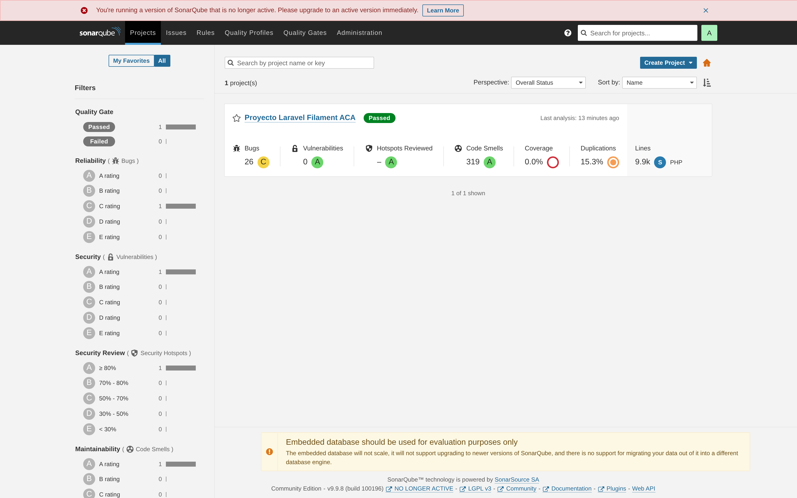

**Figura 1.** Proyecto `laravel-filament-aca` registrado y analizado en la instancia local.
Sustenta la Ficha Técnica y la sección 3.1.

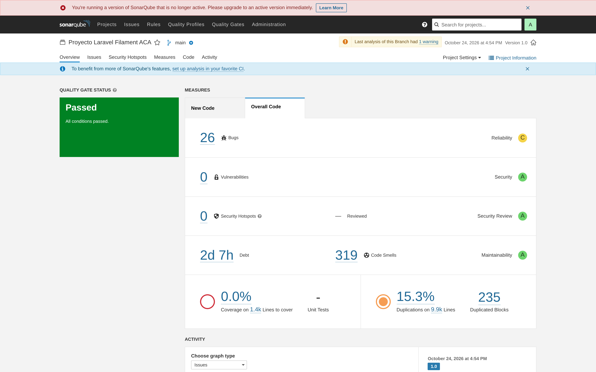

**Figura 2.** Vista *Overview → Overall Code*: **26 bugs**, **0 vulnerabilidades**, **deuda 2d 7h**,
**319 code smells**, **cobertura 0,0 %**, **duplicación 15,3 %** y ratings
Fiabilidad **C**, Seguridad **A**, Mantenibilidad **A**. Evidencia central de la matriz ISO 25010.

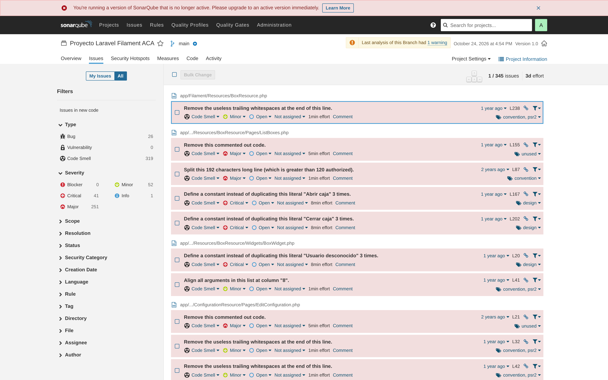

**Figura 3.** **345 issues** abiertas con facetas por tipo (26 bug / 0 vulnerabilidad / 319 code
smell) y severidad (41 críticas, 251 mayores, 52 menores, 1 informativa). Sustenta la sección 4.4.

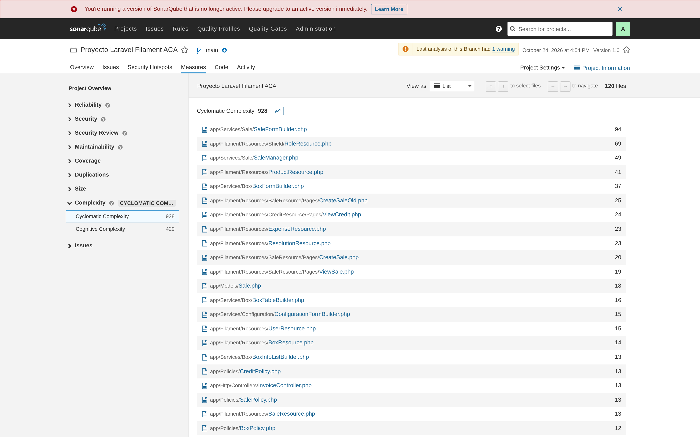

**Figura 4.** Complejidad ciclomática total **928** y ranking por archivo:
`SaleFormBuilder` 94, `Shield/RoleResource` 69, `SaleManager` 49, `ProductResource` 41.
Sustenta la métrica de v(G) de la matriz.

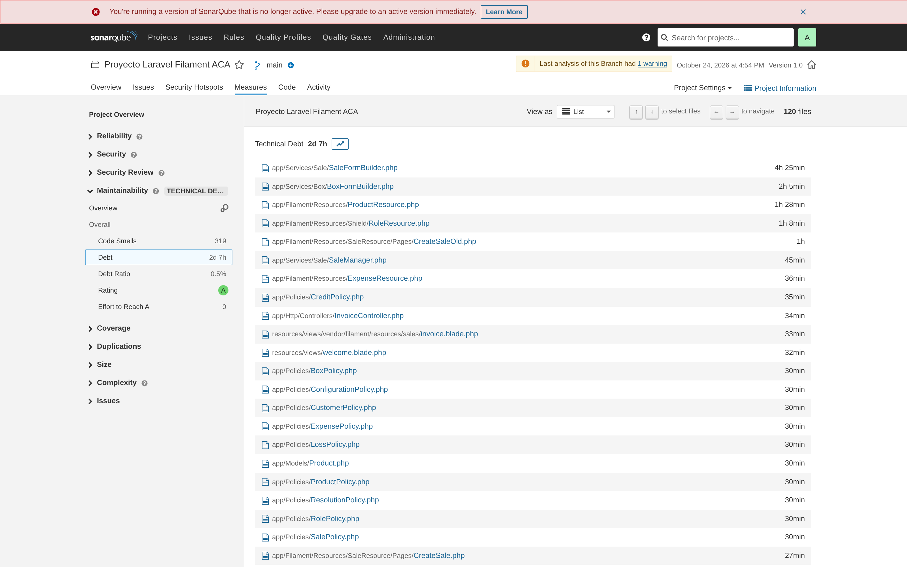

**Figura 5.** Desglose de la deuda: `SaleFormBuilder` 4 h 25 min, `BoxFormBuilder` 2 h 05 min,
`ProductResource` 1 h 28 min, `CreateSaleOld` 1 h. Insumo directo del plan de refactorización.

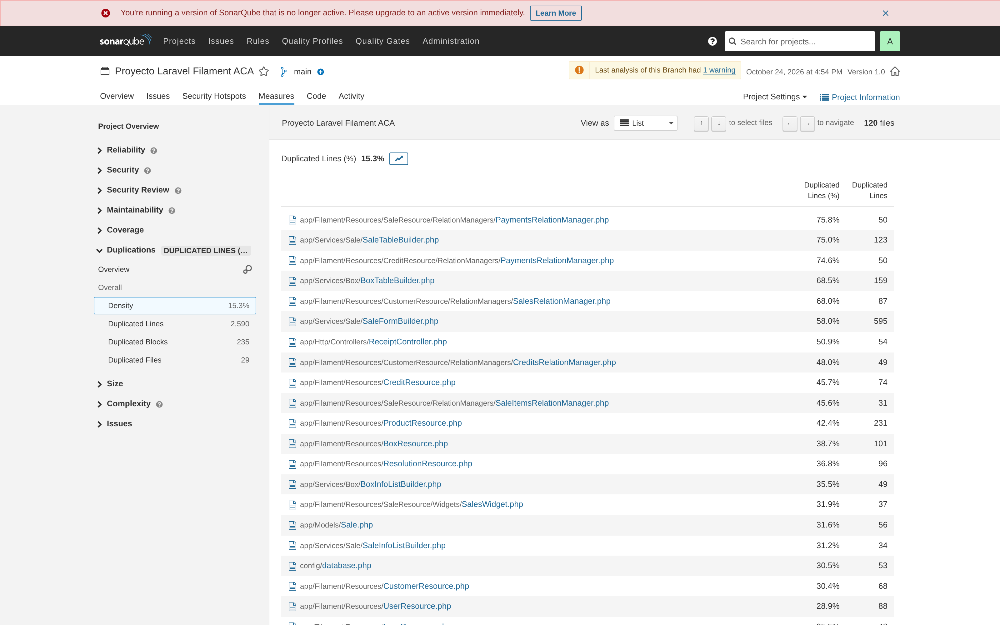

**Figura 6.** Duplicación por archivo (15,3 % global, 2.590 líneas): `PaymentsRelationManager`
75,8 %, `SaleTableBuilder` 75,0 %, `CreditResource/PaymentsRelationManager` 74,6 %,
`BoxTableBuilder` 68,5 %, `SaleFormBuilder` 595 líneas (58,0 %).

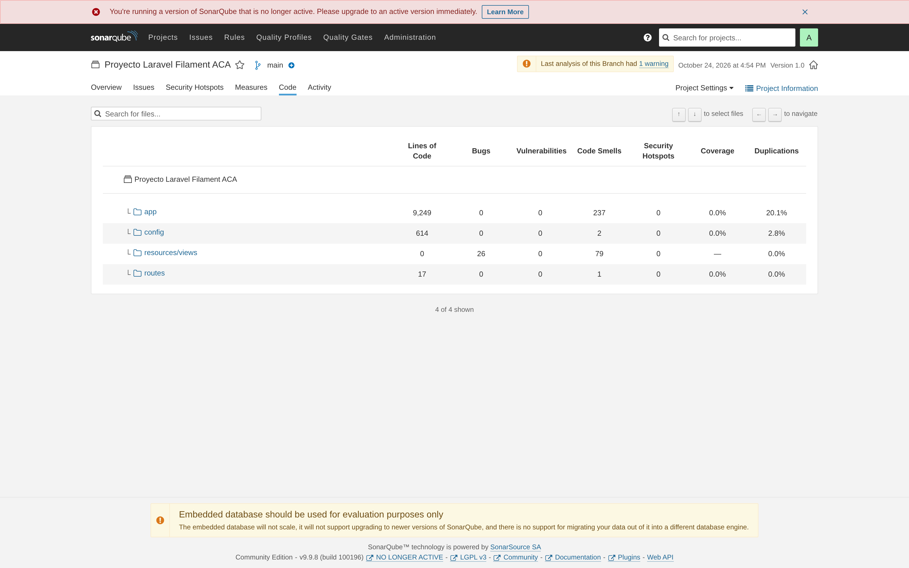

**Figura 7.** Vista *Code*: `app` 9.249 LOC con 237 code smells y 20,1 % de duplicación;
`resources/views` concentra los **26 bugs** (accesibilidad de las plantillas de impresión).

### 8.2 PhpMetrics 2.11.0 — informe sobre `app/`

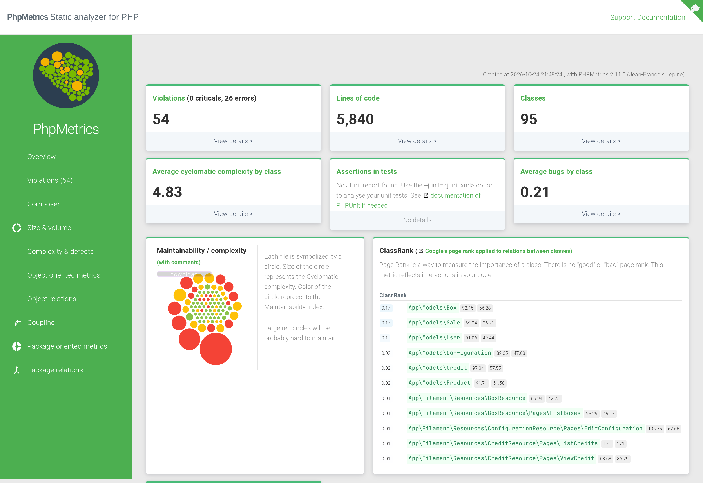

**Figura 8.** Resumen: **5.840 LOC**, **95 clases**, **54 violaciones** (0 críticas, 26 errores),
CCN medio **4,83** y mapa de mantenibilidad por clase (círculo = v(G), color = MI).

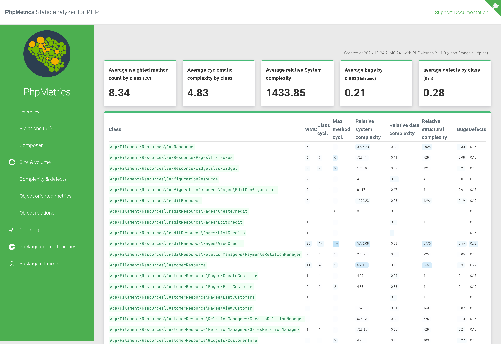

**Figura 9.** Tabla WMC / complejidad de clase / **v(G) máximo por método** / complejidad relativa.
Permite verificar `ViewCredit` (v(G) máx. 16), `CustomerResource` (11) y `BoxWidget` (8).

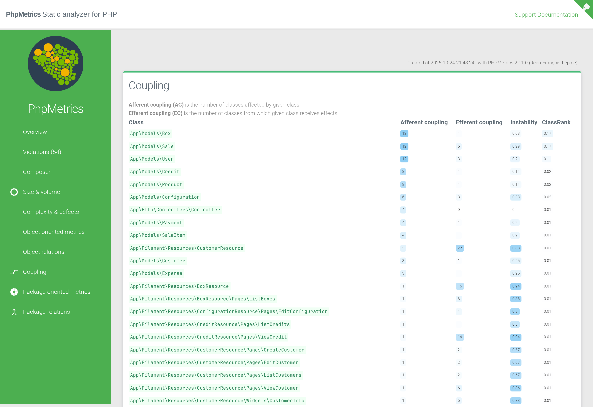

**Figura 10.** Acoplamiento aferente/eferente e inestabilidad por clase; sostiene el análisis de
Ca = 1,24 / Ce = 5,76 / I = 0,80 y el Ce = 28 de `ProductResource`.

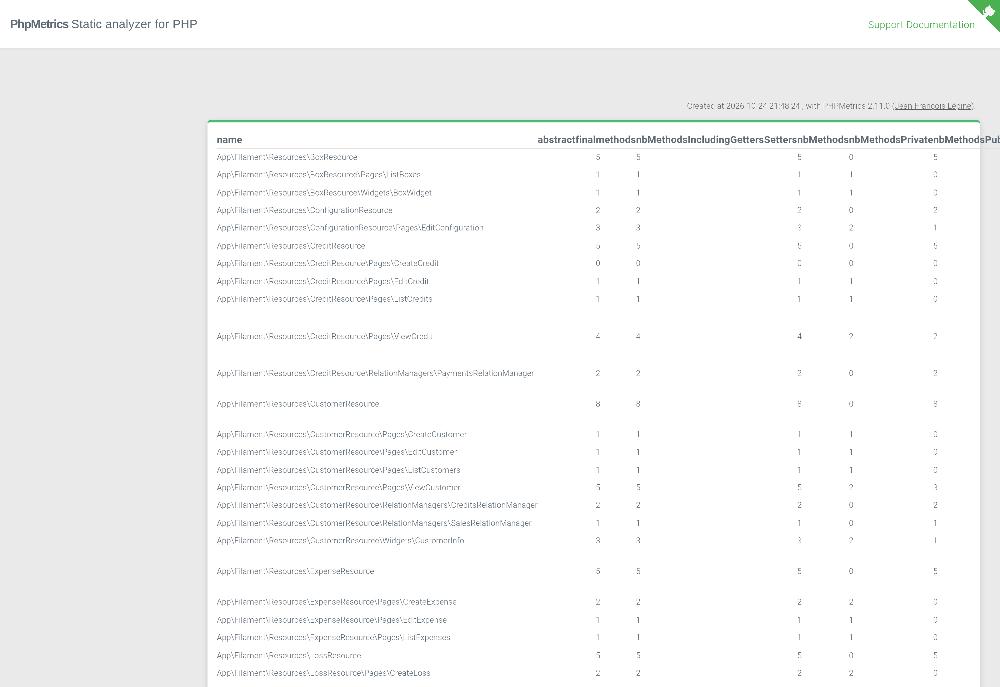

**Figura 11.** Inventario de las 95 clases con LOC, MI y violaciones; base de las tablas de la
sección 4.2.

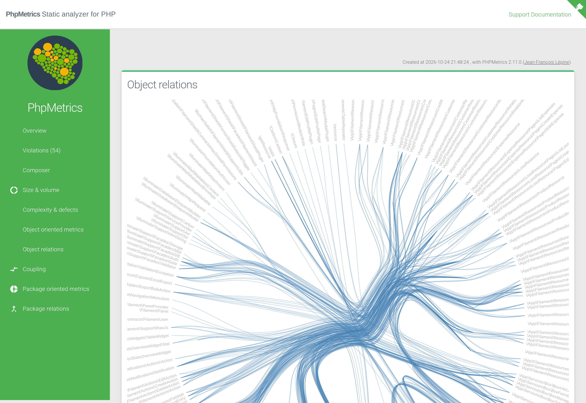

**Figura 12.** Grafo de dependencias (anexo visual): evidencia la densidad de acoplamiento de los
`*FormBuilder` y `*TableBuilder` hacia las clases de Filament.

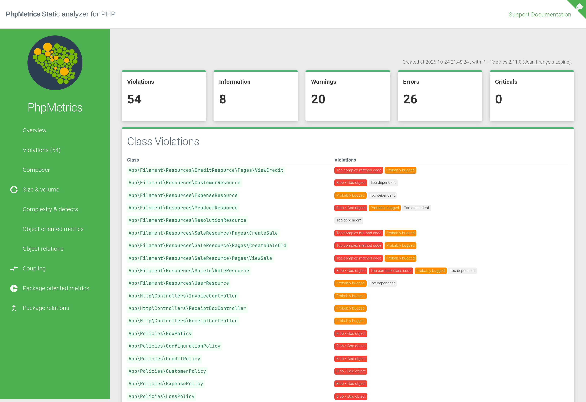

**Figura 13.** Las 54 violaciones agrupadas por tipo (clases demasiado largas, demasiado
dependientes, probablemente defectuosas).

### 8.3 Guía de uso en el documento académico

| Figura | Sección del reporte que evidencia |
|---|---|
| 1, 2 | Ficha técnica · Matriz ISO 25010 (fila completa) |
| 3, 7 | Fiabilidad (26 bugs) y Capacidad de prueba (cobertura 0 %) |
| 4 | Mantenibilidad — complejidad ciclomática |
| 5 | Plan de refactorización (priorización por deuda) |
| 6 | Mantenibilidad — duplicación |
| 8, 9 | Mantenibilidad — MI y v(G) |
| 10, 12 | Acoplamiento e inestabilidad |
| 11, 13 | Anexo de inventario de clases y violaciones |

> **Nota:** SonarQube muestra el aviso *"You're running a version of SonarQube that is no longer
> active"*. Es una advertencia sobre la **herramienta** (9.9 LTS fuera de soporte), no sobre el
> código evaluado; para un entorno real debe migrarse a la rama 2025/2026 LTA.

---

*Documento generado a partir de la ejecución real de las herramientas sobre el árbol de trabajo del
24/10/2026. Todos los valores son reproducibles con los comandos del Anexo 7.1; las evidencias
gráficas están en `docs/capturas/`.*
